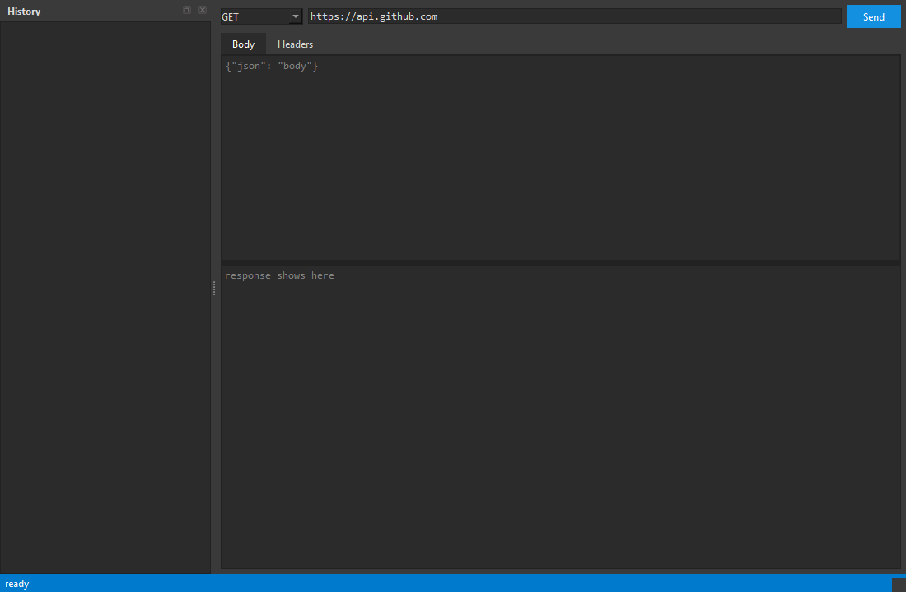

# postbox

a tiny local postman. pick a method, paste a url, add headers + body,
hit send, get a pretty response with status code, timing, headers and
formatted json.

## run it

```
py -3.14 -m pip install PySide6
py -3.14 postbox.py
```

## what it looks like



## stuff it does

- GET/POST/PUT/PATCH/DELETE/HEAD/OPTIONS
- headers table for custom headers
- body editor for json/text payloads
- response pane: status line, first headers, pretty-printed json
  (or raw text if it isnt json)
- timing in ms + byte count
- history sidebar - last 50 requests saved to history.json, double
  click to reload one
- requests run on a worker thread so the ui never freezes

## honest limits

- no auth helpers or collections yet, headers only
- no file upload / form-data mode
- its urllib under the hood so weird ssl setups might complain
